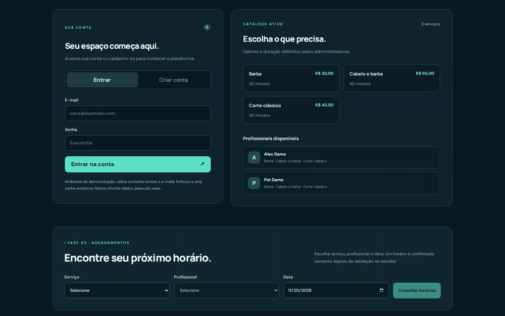
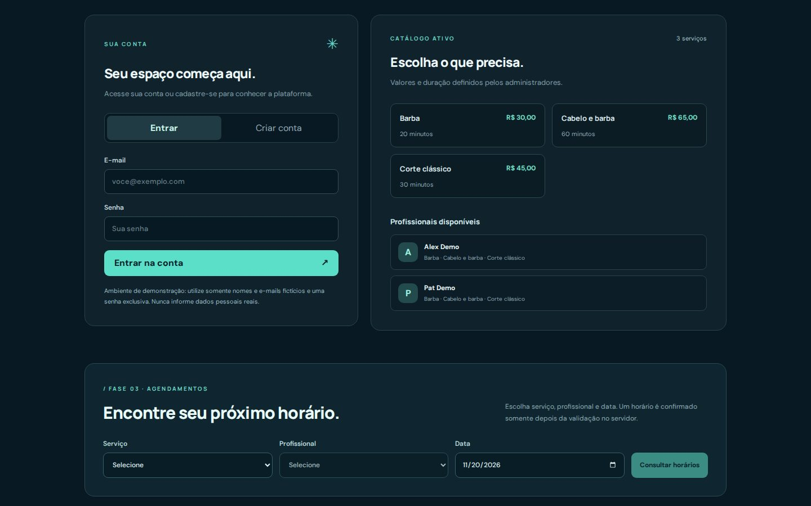
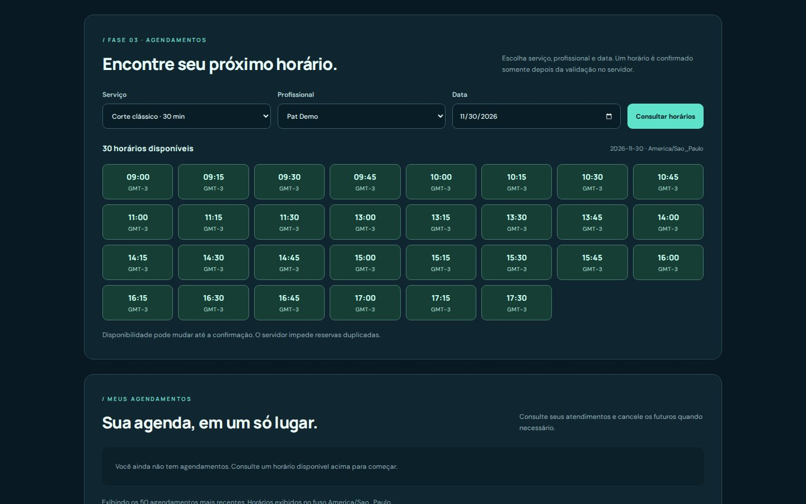
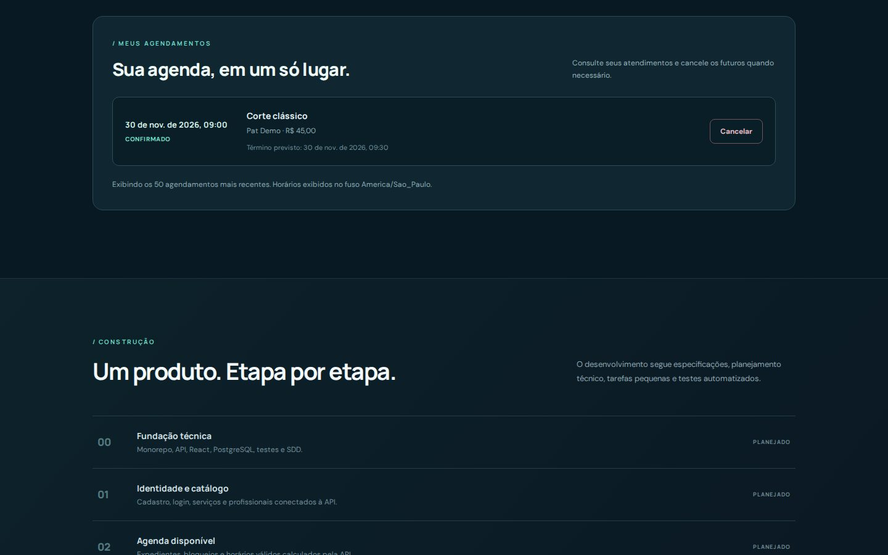
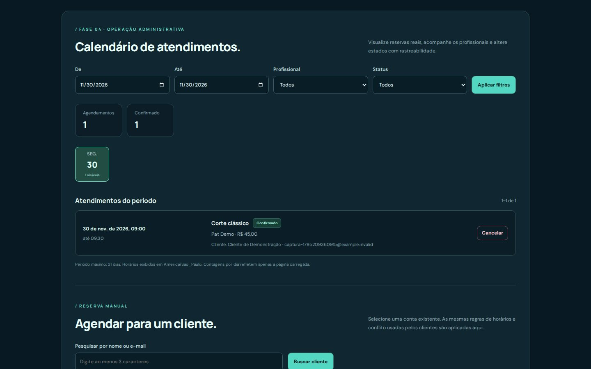
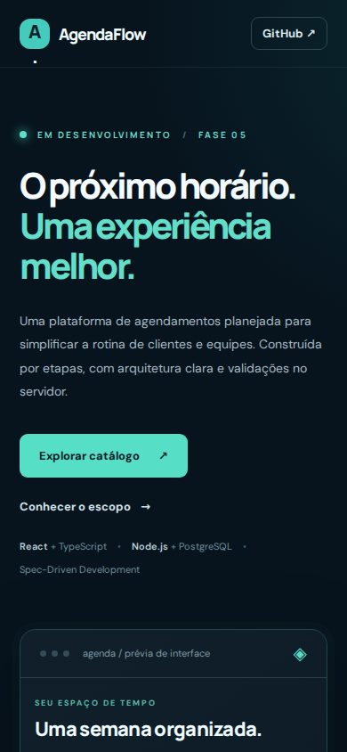

# AgendaFlow

[](https://github.com/mateusfaria854-bit/agendaflow/actions/workflows/ci.yml)
[](https://github.com/mateusfaria854-bit/agendaflow/actions/workflows/e2e.yml)
[](https://github.com/mateusfaria854-bit/agendaflow/actions/workflows/container-demo.yml)
[](https://github.com/mateusfaria854-bit/agendaflow/actions/workflows/demo-uptime.yml)
[](https://github.com/mateusfaria854-bit/agendaflow/actions/workflows/readme-media.yml)
[](https://github.com/mateusfaria854-bit/agendaflow/actions/workflows/backup-restore.yml)
[](https://github.com/mateusfaria854-bit/agendaflow/actions/workflows/backup-image.yml)

**Plataforma full-stack de agendamentos** em desenvolvimento, com React, TypeScript, Node.js, Fastify e PostgreSQL. O projeto segue **Spec-Driven Development (SDD)** e prioriza uma arquitetura clara, requisitos verificáveis e prevenção de reservas duplicadas.

> **Estado atual: MVP full-stack com demonstração online na Railway.** Clientes reservam e cancelam, administradores gerenciam a agenda e profissionais consultam seus atendimentos. API Fastify e frontend React podem ser executados **na mesma origem HTTP/HTTPS**, com Docker, CI e E2E. **Demo hospedada e verificada externamente em HTTPS:** o frontend/API e PostgreSQL estão online na Railway, com smoke test periódico de disponibilidade. **Somente dados fictícios:** há backup lógico diário do PostgreSQL para bucket privado com restauração isolada e download validado. Permanecem pendentes backups nativos do volume, política de retenção e alertas, além de proteção contra abuso distribuído e revisão de privacidade.

## Demonstração

> Capturas **reais da interface em execução**, produzidas com Playwright e PostgreSQL **descartável**, utilizando apenas contas e agendamentos fictícios. A prévia de calendário no banner da página inicial é conceitual; as telas de catálogo, consulta de horários, reservas e administração abaixo são funcionais.

### Agendamento de ponta a ponta (GIF)

[](https://agendaflow-web-production.up.railway.app/)

### Telas do sistema

| Página inicial | Catálogo de serviços | Horários disponíveis |
| :---: | :---: | :---: |
|  |  |  |

| Meus agendamentos | Calendário administrativo | Versão mobile |
| :---: | :---: | :---: |
|  |  |  |

**Testar online:** [AgendaFlow na Railway](https://agendaflow-web-production.up.railway.app/) · **Atualizar os registros visuais:** [workflow de capturas Playwright](.github/workflows/readme-media.yml). As imagens são geradas no ambiente de testes, não por dados de visitantes reais.

## Objetivo

Organizar serviços, profissionais e horários para um único negócio de atendimentos. O MVP permite reservar, consultar e cancelar agendamentos, com validação de conflito no backend e no PostgreSQL. Nesta etapa já é possível cadastrar usuários e administrar serviços e profissionais.

## Tecnologias

| Camada | Tecnologias |
|---|---|
| Frontend | React 19, TypeScript, Vite 6, CSS |
| Backend | Node.js 22, Fastify 5, TypeScript |
| Banco | PostgreSQL 16, migrações SQL e dados fictícios |
| Organização | Npm workspaces, contratos compartilhados, SDD, ADRs |
| Qualidade | Node Test Runner, PostgreSQL de teste, Playwright, axe, GitHub Actions |

## Organização do repositório

```text
apps/
  web/                  Interface React
  api/                  API Fastify e migrações PostgreSQL
packages/
  shared/               Contratos e funções puras
specs/
  constitution.md       Princípios de desenvolvimento
  000-fundacao/         Requisitos, plano e tarefas da Fase 0
  001-autenticacao/     Autenticação e perfis
  002-catalogo/        Gestão de serviços e profissionais
  003-disponibilidade/ Horários, jornada e bloqueios
  004-agendamentos/    Reserva, listagem e cancelamento transacionais
  005-operacao-administrativa/ Calendário e gestão administrativa
  006-area-profissional/       Complemento de acesso por profissional
  007-polimento-publicacao/    Testes E2E, segurança e preparação de demo
  008-demo-hospedagem/        Docker e configuração para hospedar
  009-retencao-demo/          Regras, testes e operação de limpeza controlada
  _templates/           Modelos de spec, plan e tasks
docs/
  media/                Prints reais e GIF do sistema
  ARQUITETURA.md        Limites e fluxo entre camadas
  GUIA_LOCAL.md         Instalação e execução
  RETENCAO_DEMO.md      Retenção segura e limpeza controlada da demo
  BACKUP_RAILWAY.md      Backup lógico privado e procedimento de recuperação
  ROADMAP.md            Fases do MVP
  adr/                  Decisões arquiteturais
scripts/                Verificação SDD e de dependências
.github/workflows/      CI
compose.yaml            PostgreSQL local
Dockerfile              Build multi-stage React + API Fastify na mesma origem
.dockerignore           Evita incluir dados e dependências locais
.github/workflows/container-demo.yml Smoke test da imagem Docker
```

## Instalação

Pré-requisitos: **Node.js 22+**, npm e Docker Compose.

```bash
npm install
cp apps/api/.env.example apps/api/.env
docker compose up -d
npm run db:migrate
npm run db:seed
npm run db:verify
```

No Windows PowerShell, utilize `Copy-Item apps/api/.env.example apps/api/.env`.

Inicie a API e a interface em terminais separados:

```bash
npm run dev:api
npm run dev:web
```

- Interface: **http://127.0.0.1:5173**
- API: **http://127.0.0.1:3333/api/v1/health**

Instruções detalhadas: [Guia local](docs/GUIA_LOCAL.md).

## Funcionalidades implementadas

- **Cadastro e login:** clientes criam conta; senhas usam scrypt e salt aleatório.
- **Sessões:** cookies HttpOnly/SameSite, hashes dos tokens no PostgreSQL, logout e expiração.
- **Permissões:** endpoints de escrita do catálogo exigem administrador; cadastro público nunca cria admin.
- **Segurança HTTP:** respostas da API usam no-store, nosniff, Referrer-Policy, Permissions-Policy e proteção contra iframe; em produção WEB_ORIGIN deve ser HTTPS, com HSTS sem preload.
- **Catálogo:** listagem pública de serviços e profissionais ativos.
- **Painel administrativo:** criação, edição, desativação e vínculo de profissionais a serviços.
- **Disponibilidade (Fase 2):** expediente semanal com pausas, bloqueios excepcionais e consulta pública de horários livres, respeitando reservas ativas e duração do serviço.
- **Agendamentos (Fase 3):** reservar um slot disponível, consultar até 50 reservas próprias e cancelar as futuras; proteção contra conflitos, preço definido pelo servidor e auditoria no PostgreSQL.
- **Calendário administrativo (Fase 4):** listar atendimentos por período, profissional e status, paginação e totais, pesquisar contas de clientes, criar reservas manuais e alterar estados com regras de transição.
- **Área profissional (complemento da Fase 4):** acesso pessoal à própria agenda, filtros de data/status, paginação e proteção contra consulta de outros profissionais, sem e-mail de cliente ou dados financeiros.
- **Qualidade (Fase 5):** testes Playwright Chromium desktop/mobile, verificação básica WCAG com axe, skip link, movimento reduzido, headers HTTP de segurança e guia de deploy seguro.

O primeiro administrador é criado pelo comando local `npm run admin:create`; uma conta profissional é provisionada com `npm run staff:provision` e vinculada a um profissional previamente cadastrado. Nenhum desses comandos possui credenciais padrão. Consulte o [Guia local](docs/GUIA_LOCAL.md) para configurar as variáveis temporárias e usar o painel. **A aplicação permite agendamentos no ambiente local e na demonstração com dados fictícios; não há integração de pagamentos nem envio de notificações.**

### Endpoints atuais

| Método | Rota | Acesso |
|---|---|---|
| POST | `/api/v1/auth/register` | Público, cadastra CLIENTE |
| POST | `/api/v1/auth/login` | Público |
| GET | `/api/v1/auth/me` | Sessão válida |
| POST | `/api/v1/auth/logout` | Sessão ou visitante |
| GET | `/api/v1/services`, `/api/v1/professionals` | Público |
| GET | `/api/v1/admin/services`, `/api/v1/admin/professionals` | Admin |
| POST/PATCH | `/api/v1/services`, `/api/v1/professionals` | Admin |
| GET | `/api/v1/availability/slots` | Público, horários disponíveis |
| GET | `/api/v1/admin/availability` | Admin, expediente/bloqueios |
| PUT | `/api/v1/admin/professionals/:id/availability` | Admin, definir expediente |
| POST/DELETE | `/api/v1/admin/blocked-periods[/id]` | Admin, bloquear e liberar períodos |
| POST | `/api/v1/appointments` | CLIENTE, confirmar reserva |
| GET | `/api/v1/appointments/mine` | CLIENTE, somente próprias reservas |
| PATCH | `/api/v1/appointments/:id/cancel` | CLIENTE titular, cancelar reserva futura |
| GET | `/api/v1/admin/appointments?from=&to=&professionalId=&status=&offset=` | ADMIN, agenda filtrada, até 100 por página |
| GET | `/api/v1/admin/clients?query=` | ADMIN, pesquisa de clientes existentes |
| POST | `/api/v1/admin/appointments` | ADMIN, reserva manual com as mesmas regras do cliente |
| PATCH | `/api/v1/admin/appointments/:id/status` | ADMIN, transições autorizadas e auditadas |
| GET | `/api/v1/staff/me` | PROFISSIONAL com conta vinculada e cadastro ativo |
| GET | `/api/v1/staff/appointments?from=&to=&status=&offset=` | PROFISSIONAL, somente própria agenda |

### Como testar o calendário administrativo

1. Inicie o PostgreSQL, a API e o frontend conforme o [guia local](docs/GUIA_LOCAL.md).
2. Entre com uma conta ADMIN criada via `npm run admin:create`.
3. No painel, abra **Calendário de atendimentos** e filtre por datas (até 31 dias), profissional e status.
4. Em **Agendar para um cliente**, pesquise um CLIENTE cadastrado, escolha serviço/profissional/data e confirme um horário disponível.
5. Use **Cancelar** em reservas futuras e **Concluir** somente após o término do atendimento. A interface acompanha as restrições da API.

A pesquisa de clientes e a lista de reservas são acessíveis apenas ao administrador. **Não há pagamentos nem e-mails automáticos; a aplicação demonstrativa está hospedada e os testes E2E são executados no GitHub Actions.**

### Como habilitar a área profissional

1. Cadastre um profissional no painel ADMIN e copie o **ID para provisionar conta** exibido abaixo do nome.
2. Configure temporariamente `PROFESSIONAL_ID`, `STAFF_NAME`, `STAFF_EMAIL` e `STAFF_PASSWORD` no terminal. A senha precisa ter entre 12 e 128 caracteres.
3. Execute `npm run staff:provision`. Esse comando cria uma conta PROFISSIONAL exclusiva e a associa à agenda; não converte nem promove contas existentes.
4. Entre com essa conta no site. O painel **Sua agenda profissional** permite consultar somente os seus próprios atendimentos por período e status.

Veja os comandos PowerShell e os cuidados com credenciais no [Guia local](docs/GUIA_LOCAL.md). A agenda do profissional é **somente leitura**. Ações administrativas continuam restritas ao ADMIN.

### Testes reais de navegador (Fase 5)

O workflow [Navegador E2E e acessibilidade](.github/workflows/e2e.yml) inicializa banco PostgreSQL descartável, cria contas **fictícias** e testa Chromium desktop e emulação mobile. Inclui registro, reserva e cancelamento por cliente, consulta do administrador, área profissional e navegação por teclado. O painel de autenticação recebe checagem axe de regras WCAG A/AA; isso não substitui auditoria completa de acessibilidade.

Para rodar localmente, inicie API, Vite e PostgreSQL (veja [Guia Local](docs/GUIA_LOCAL.md)), execute `npx playwright install chromium` e `npm run test:e2e`. Para ativar também os testes de ADMIN e PROFISSIONAL, configure `E2E_ADMIN_EMAIL`, `E2E_ADMIN_PASSWORD`, `E2E_STAFF_EMAIL` e `E2E_STAFF_PASSWORD` com **credenciais fictícias de ambiente descartável**. Não aponte os testes para uma instância com clientes reais.

### Preparar um deploy demonstrativo

O projeto agora fornece um **Dockerfile único**. O build inclui o React compilado e a API Fastify; na imagem, `SERVE_WEB=true` permite acessar frontend e `/api/v1` na mesma origem, sem CORS entre dois serviços.

```bash
docker build -t agendaflow:demo .
```

A imagem exige `DATABASE_URL` de um PostgreSQL separado e, por segurança, `WEB_ORIGIN=https://seu-dominio` na execução com `NODE_ENV=production`. O banco **não** é incluído na imagem. O comando de migração compilada, sem dependências de desenvolvimento, é `npm run db:migrate:runtime -w @agendaflow/api`. O script `npm run db:demo:bootstrap` combina migrações e seed fictício, e é usado no pre-deploy Railway. Para um banco **descartável de demo**, o seed pode ser aplicado com `npm run db:seed:runtime -w @agendaflow/api`.

Para uma demo aberta, configure `DEMO_MODE=true` no serviço: cadastros aceitam apenas endereços **fictícios @example.invalid**, com limite conservador de 5 tentativas de cadastro por IP a cada 15 minutos na instância de API. Essa proteção em memória não substitui limites distribuídos na borda. Isso evita e-mails reais, mas ainda são necessários limites contra abuso, limpeza periódica do banco e monitoramento.

[Guia passo a passo para Railway e outros provedores](docs/DEPLOY_DEMO.md). A demonstração foi implantada e passou na checagem externa HTTPS em 20/11/2026. Evite inserir dados pessoais, senhas reutilizadas ou clientes reais.

### Retenção e limpeza segura da demonstração

O AgendaFlow agora possui um comando de manutenção com **simulação por padrão**, testes PostgreSQL e bloqueio explícito contra uso fora do modo demo. Só considera clientes fictícios com idade e última atividade superiores a 30 dias, sem horários recentes/futuros, e exclui suas dependências em transação. **A exclusão automática continua desativada**. O backup lógico independente do Postgres da Railway foi criado, restaurado em PostgreSQL temporário e recuperado do bucket com verificação byte a byte; falta fechar política de retenção/alertas antes de agendar o expurgo.

Guia: [Retenção de dados fictícios](docs/RETENCAO_DEMO.md). O [workflow de integração](.github/workflows/backup-restore.yml) usa bancos descartáveis; adicionalmente, o [backup real da Railway](docs/BACKUP_RAILWAY.md) envia dumps verificados a um bucket privado diariamente.

### Publicação demonstrativa

Uma instância de demonstração foi **implantada na Railway em 20/11/2026** (`agendaflow-demo`, ambiente `production`): serviço web React/Fastify, PostgreSQL privado com volume, migrações e seed fictício executados pelo comando `npm run db:demo:bootstrap`, e healthcheck `/api/v1/ready` aprovado. O domínio HTTPS [AgendaFlow Demo](https://agendaflow-web-production.up.railway.app/) teve **DNS, TLS, frontend, API e conexão com PostgreSQL verificados externamente** pelo workflow [Disponibilidade da demo HTTPS](.github/workflows/demo-uptime.yml), executado no GitHub Actions e agendado a cada 6 horas.

A implantação segue a branch `main` e usa `DEMO_MODE=true`, que restringe cadastros públicos a e-mails **fictícios** `@example.invalid`. Uma URL pública **não significa produção comercial pronta**: faltam proteção contra abuso distribuído, política de retenção/expurgo, backup nativo do volume, alertas operacionais, observabilidade completa e revisão LGPD. O backup lógico independente já foi validado. **Não cadastrar clientes reais, nem usar senhas pessoais.** Pagamentos, notificações e recuperação de senha não fazem parte do MVP. Consulte o [Guia de implantação](docs/DEPLOY_DEMO.md) para operação, backup e rollback.

### Backup e restauração em ambiente de testes

O workflow [Backup e restauração PostgreSQL](.github/workflows/backup-restore.yml) executa `pg_dump` e `pg_restore` com **dados sintéticos em banco isolado** e verifica tabelas, migrações e a restrição contra reservas sobrepostas. Esse teste foi aprovado. **Além dele**, um serviço de backup privado na Railway executou com sucesso `pg_dump`, `pg_restore` em PostgreSQL temporário e upload/download S3 com comparação de bytes. O job segue um agendamento diário de 03:20 UTC. Consulte o [guia de backup da Railway](docs/BACKUP_RAILWAY.md). Os snapshots nativos do volume e a retenção/alertas do bucket ainda precisam ser configurados.

## Testes e verificações

```bash
npm run check
npm run db:migrate
npm run db:seed
npm run db:verify
```

O CI [Qualidade e banco](.github/workflows/ci.yml) executa build, testes, verificações arquiteturais, migrações e integração real com PostgreSQL. [E2E e acessibilidade](.github/workflows/e2e.yml) testa o navegador, e [Contêiner de demonstração](.github/workflows/container-demo.yml) compila a imagem e verifica frontend/API na mesma origem. **Os três workflows precisam passar antes do merge.** O seed é idempotente.

## Processo SDD

Cada funcionalidade tem três documentos versionados em `specs/NNN-nome/`: `spec.md` (requisitos e aceite), `plan.md` (arquitetura e dados), e `tasks.md` (execução e testes). O conjunto de princípios está em [specs/constitution.md](specs/constitution.md).

Especificações implementadas: [Fundação](specs/000-fundacao/spec.md), [Autenticação](specs/001-autenticacao/spec.md), [Catálogo](specs/002-catalogo/spec.md), [Disponibilidade](specs/003-disponibilidade/spec.md), [Agendamentos](specs/004-agendamentos/spec.md) e [Operação administrativa](specs/005-operacao-administrativa/spec.md), incluindo o [complemento de área profissional](specs/006-area-profissional/spec.md) e a [Fase 5](specs/007-polimento-publicacao/spec.md), incluindo a [preparação de deploy Docker](specs/008-demo-hospedagem/spec.md). A demonstração externa foi implantada e verificada em HTTPS, mas a operação com dados reais depende de controles adicionais.

## Próximas fases

Confira o [Roadmap](docs/ROADMAP.md) e as [Issues planejadas](https://github.com/mateusfaria854-bit/agendaflow/issues). O planejamento contempla identidade, catálogo, disponibilidade, reservas, operação administrativa, testes E2E e publicação demonstrativa. A demonstração online segue o repositório GitHub na Railway; alterações só devem ser divulgadas após a confirmação dos testes e do deploy. A produção com dados reais exige controles de segurança e operação adicionais.

## Segurança e escopo

O frontend não acessa o banco diretamente. A API verifica autenticação e permissões administrativas; reservas do cliente e reservas manuais passam pelo mesmo serviço transacional. O calendário administrativo só devolve informações administrativas aos administradores; a agenda do profissional consulta apenas agendamentos vinculados à própria sessão, sem e-mail do cliente ou valores. Mudanças de status obedecem uma máquina de estados com auditoria. O PostgreSQL impede sobreposição de reservas `PENDENTE` e `CONFIRMADO`. O cancelamento preserva o histórico e libera o horário. Pagamentos e notificações ainda não estão implementados.

Não são utilizadas credenciais de produção ou dados reais. Os valores em `compose.yaml` e no workflow E2E são apenas para ambientes descartáveis. Antes de utilizar dados reais, são necessárias mais medidas de proteção, recuperação de senha, controle distribuído de abusos, monitoramento, política de dados e revisão LGPD.

## Autoria

**Mateus Faria Andrade** · Engenharia de Software, UniRV

[GitHub](https://github.com/mateusfaria854-bit) · [Arquitetura](docs/ARQUITETURA.md) · [Decisões técnicas](docs/adr/0001-monorepo-e-postgresql.md)
